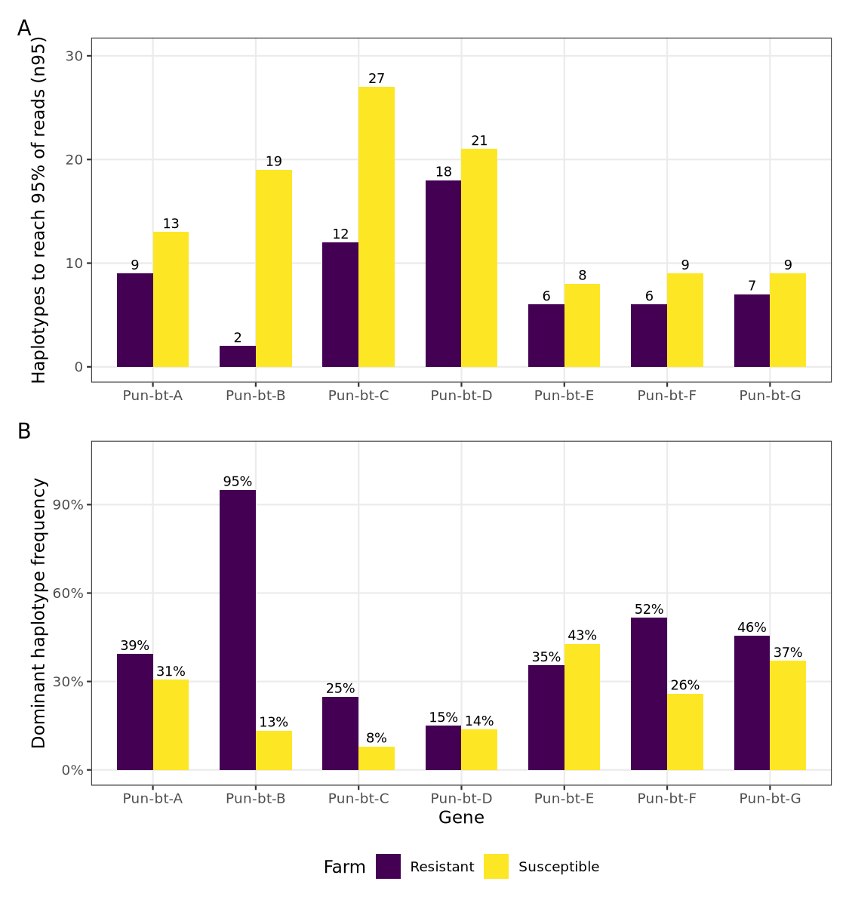

# β-tubulin haplotypes and benzimidazole resistance in *Parascaris univalens*

Code and data for:

> Tydén E, Martin F, Dube F. **Novel β-tubulin mutations and haplotype restructuring associated with benzimidazole resistance in *Parascaris univalens*.** PLOS ONE (submitted).

All seven β-tubulin genes (Pun-bt-A to Pun-bt-G) were sequenced as long amplicons with PacBio HiFi, from pooled eggs of a benzimidazole-resistant farm (Farm-R) and a susceptible farm (Farm-S). This repository holds:
- the processing pipeline, which goes from reads to haplotypes, variants and identity matrices;
- the R code that regenerates every figure and table in the paper from the files in `data/`.



## Data availability

| Data | Location |
|---|---|
| Per-gene normalised HiFi reads (14 runs, ERR15943804 to ERR15943817) | ENA [PRJEB102621](https://www.ebi.ac.uk/ena/browser/view/PRJEB102621) |
| Haplotype consensus FASTA (243 haplotypes, 7 genes × 2 farms) | [`data/haplotypes/`](data/haplotypes/) |
| Haplotype coding sequences, filtered VCFs, VEP tables | `data/haplotype_cds/`, `data/variants/` |
| Archived snapshot of this repository | Zenodo [10.5281/zenodo.XXXXXXX](https://doi.org/10.5281/zenodo.XXXXXXX) |
| Processing pipeline | `pipeline/` (see [`pipeline/README.md`](pipeline/README.md)) |

## Repository structure

```
data/        haplotype FASTA and CDS, identity matrices, VCFs and VEP tables, CDS protein
             alignments, RNA-seq quantifications, references, gene map (see data/README.md)
scripts/     R and bash code for every figure and table; qa/ holds the checks
figures/     Fig1-Fig6 and S1_Fig-S8_Fig (TIFF for the journal, PNG previews)
tables/      Table1, S1_Table, S2_Table, S3_Table (CSV)
results/     intermediate tables written by scripts/ and read by the QA check
pipeline/    Nextflow pipeline: HiFi reads -> haplotypes, variants, identity matrices
envs/        pinned R environment
```

## Figures and tables

| Output | Content | Regenerated by |
|---|---|---|
| Table 1 | β-tubulin genes, primers and amplicon sizes | `08_tables_metadata.R` |
| Fig 1 | Haplotypes needed for 95% of reads (n95); dominant haplotype frequency | `01_haplotype_diversity.R` |
| Fig 2 | PCA of Pun-bt-B and Pun-bt-C haplotypes | `02_metahaplotype_clustering.R` |
| Fig 3 | Meta-haplotype enrichment and depletion across genes | `02_metahaplotype_clustering.R` |
| Fig 4 | Farm-exclusive intronic and splice-proximal variants | `03_intronic_variants.R` |
| Fig 5 | Positions of farm-exclusive intronic variants, Pun-bt-B and Pun-bt-C | `03_intronic_variants.R` |
| Fig 6 | β-tubulin expression and response to thiabendazole | `07_expression_tbz.R` |
| S1 Fig | Pun-bt-B dendrogram with candidate cut heights | `02_metahaplotype_clustering.R` |
| S2 and S4 Fig | Group distribution by farm, Pun-bt-B and Pun-bt-C | `02_metahaplotype_clustering.R` |
| S3 and S5 Fig | Mean cluster diversity by group and farm, Pun-bt-B and Pun-bt-C | `02_metahaplotype_clustering.R` |
| S6 Fig | PCoA of identity matrices, Pun-bt-B, -C, -F, -G | `05_gst_pcoa.R` |
| S7 Fig | Nei's G_ST per gene | `05_gst_pcoa.R` |
| S8 Fig | Scaffold map of the seven genes | `06_scaffold_map.R` (coordinates from `06_extract_btubulin_coords.sh`) |
| S1 Table | Read depth before and after normalisation | `08_tables_metadata.R` |
| S2 Table | Amino-acid variants with Fisher tests | `04_coding_variants.R` (after `03_intronic_variants.R`) |
| S3 Table | Per-gene G_ST and heterozygosities | `05_gst_pcoa.R` |

## Running the analyses

```bash
# 1. Environment (linux-64; Bioconductor 3.17 packages are not built for Apple silicon)
micromamba create -f envs/r-figures.yml      # or: conda env create -f envs/r-figures.yml
micromamba activate pun-btub-r

# 2. Everything, from the repository root
bash scripts/run_all.sh
```

`run_all.sh` runs scripts `01` to `08` in order and then `scripts/qa/check_manuscript_numbers.R`. That check compares the regenerated values with the numbers stated in the manuscript text and writes `results/qa_manuscript_numbers.csv`. Any single script can also be run on its own, for example `Rscript scripts/05_gst_pcoa.R`.

The pinned environment is R 4.3.3, ggplot2 3.5.1, DESeq2 1.40.2, tximport 1.28.0 and Biostrings 2.68.1. `envs/r-figures.linux-64.lock.txt` is the exact package list (`conda create -n pun-btub-r --file envs/r-figures.linux-64.lock.txt`). The figures and tables in this repository were produced in that environment. Every R script ends with `sessionInfo()`.

Two helpers need the WormBase ParaSite GFF3 and are not part of `run_all.sh`; their outputs are already in `data/`:
- `scripts/06_extract_btubulin_coords.sh` writes `data/reference/btubulin_coords.tsv` from the WBPS19 GFF3.
- `scripts/07a_make_tx2gene.R` writes `data/rnaseq/tx2gene.tsv` from the WBPS17 GFF3.

## Processing pipeline

`pipeline/` is a Nextflow (DSL2) pipeline that runs the same tools, versions and parameters as the jobs that produced the published intermediate files:
- **reads:** pbmm2 → freebayes → bcftools;
- **haplotypes:** pbaa → orientation → CDS extraction → MAFFT and Clustal Omega identity matrices;
- **QC:** vsearch.

`pipeline/tests/compare_to_published.py` checks a run against the published files. See [`pipeline/README.md`](pipeline/README.md).

## Quality control

- `scripts/qa/check_manuscript_numbers.R` compares manuscript numbers with the regenerated results.
- `scripts/qa/scan_private.sh` blocks private material from commits. Enable it with `git config core.hooksPath .githooks`.

## Gene nomenclature

Gene names follow Roose et al. (2021). `data/metadata/gene_map.tsv` is the single source of the name-to-ID mapping: Pun-bt-A = PgR007_g022, Pun-bt-B = PgR003_g161, Pun-bt-C = PgE153_g002, Pun-bt-D = PgB10_g062, Pun-bt-E = PgB04_g136, Pun-bt-F = PgB04_g135, Pun-bt-G = PgR045_g070.

## Licence

- Code (`scripts/`, `pipeline/`): MIT ([LICENSE](LICENSE)).
- Figures, tables and data: CC BY 4.0 ([LICENSE-CONTENT.md](LICENSE-CONTENT.md)).

## Citation

See [CITATION.cff](CITATION.cff).
